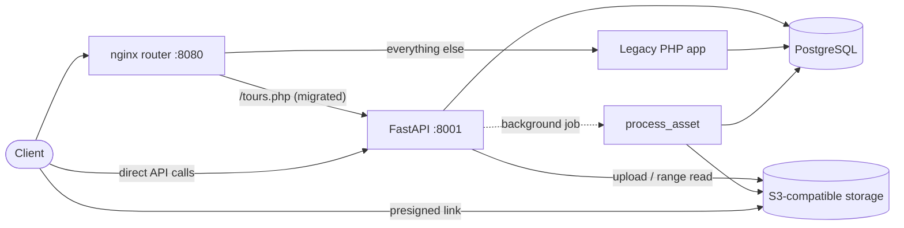

# TourVault

A backend for virtual hospital tours: it stores tours and their 3D files (`.glb`, `.ply`), controls who can change them, processes uploads in the background, and replaces a legacy PHP endpoint without breaking its clients.

I built it to understand the problems behind a "digital front door" product for hospitals: large 3D assets, patient-facing security, and migrating off an old PHP system.

## Architecture



- **FastAPI** handles HTTP, validation and auth. SQL lives in `app/db.py` (a repository layer), storage in `app/storage.py`, auth in `app/auth.py`.
- **PostgreSQL** stores tours, users, the audit log and asset metadata.
- **S3-compatible storage** (RustFS locally) stores the 3D files. The code uses the standard S3 API through boto3, so pointing it at AWS S3 is a configuration change.
- **nginx** sits in front of the old PHP app and the new API, so routes can move across one at a time (strangler fig pattern).

## What it does

| Area | Details |
|---|---|
| Tours | Create, read, update, delete; pagination (`limit` 1 to 100, `offset`); filter by hospital |
| Auth | Register, login with bcrypt-hashed passwords, JWT access tokens (30 min expiry) |
| Roles | Viewers can read; only admins can create, update, delete or upload. 401 if not logged in, 403 if not allowed |
| Audit log | Every admin create, update and delete records who did it, to which tour, and when |
| 3D assets | Upload `.glb` / `.ply` (type and size checked), stored under random UUID keys, downloaded through 10-minute presigned links |
| Processing | A background job reads only the first 64 KB of each file (HTTP range request), parses the PLY header, and moves the asset from `uploaded` to `processing` to `ready` or `failed` |
| Legacy migration | `/legacy/tours` reproduces the old PHP `/tours.php` JSON exactly, but with parameterised SQL |

## Running it

Requires Docker and Python 3.10 or later (tested on 3.14).

```bash
docker compose up -d                 # PostgreSQL, S3 storage, legacy PHP, nginx router
python -m venv .venv
.venv\Scripts\activate               # Windows (source .venv/bin/activate on macOS/Linux)
pip install -r requirements.txt
python -m uvicorn app.main:app --reload --port 8001
```

- API docs: http://127.0.0.1:8001/docs
- Through the router: http://localhost:8080/tours.php
- Storage console: http://localhost:9001/rustfs/console/

New users register as viewers. To make an admin locally:

```bash
docker compose exec db psql -U postgres -d tourvault -c "UPDATE users SET role = 'admin' WHERE email = 'you@example.com';"
```

## Tests

```bash
python -m pytest
```

32 tests run against a separate `tourvault_test` database that is rebuilt from `schema.sql` on every run and emptied before each test, so they never touch development data. They cover:

- password hashing, registration, login, and the same 401 message for unknown email and wrong password
- permissions (401 / 403), validation (422), missing resources (404), duplicate email (409)
- that a user cannot make themselves an admin by sending `"role": "admin"`
- that SQL injection in the hospital filter is harmless
- that create, update and delete are audited, and a failed update is not
- the PLY parser, including stopping at `end_header`
- that the new legacy endpoint returns exactly the old PHP contract

## Design decisions

- **Files in object storage, metadata in PostgreSQL.** Large 3D files would bloat the database; the table stores where each file lives, its size, owner and status.
- **Random object keys, not user filenames.** Avoids clashes and path tricks; the original name is kept only for display.
- **Presigned downloads.** Clients download straight from storage, so large files never pass through the API.
- **The server assigns roles.** `/register` ignores any role the client sends.
- **Audit history outlives tours.** `audit_log.tour_id` has no foreign key, so deleting a tour keeps its history.
- **Keep the legacy contract, fix the security bug.** The migrated endpoint keeps quirks like upper-cased titles (clients may depend on them) but uses parameterised SQL.

## Known limitations and what I would do next

- **The tour change and its audit row are separate transactions.** A crash between them could leave a change with no record. Next step: write both in one transaction.
- **Background jobs run in the API process** (FastAPI `BackgroundTasks`). A restart loses in-flight jobs. Production would use a queue (for example SQS) with retries.
- **Upload size is checked using the size the client reports.** Production should count bytes while streaming, or have clients upload directly to storage with a presigned upload URL.
- **`.glb` files are stored but not parsed yet.**
- **Lost updates.** Two admins editing the same tour at once: the second overwrites the first. A `version` column with a 409 on mismatch would fix it.
- **Secrets have local defaults.** `SECRET_KEY`, database and storage credentials come from environment variables in production; the defaults are for local development only.
