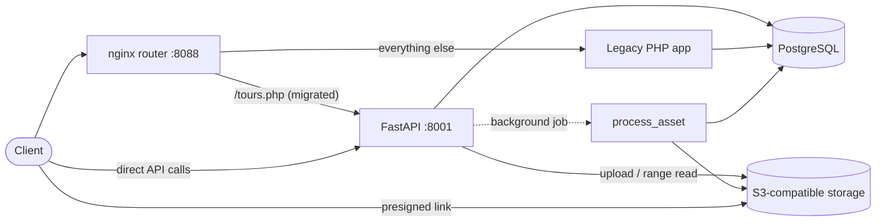
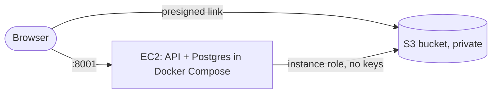

# TourVault

A backend for virtual hospital tours: it stores tours and their 3D files (`.glb`, `.ply`), controls who can change them, processes uploads in the background, and replaces a legacy PHP endpoint without breaking its clients.

I built it to understand the problems behind a "digital front door" product for hospitals: large 3D assets, patient-facing security, and migrating off an old PHP system.

**Live demo:** http://51.24.118.98:8001 (a small demo page with a Three.js viewer) and http://51.24.118.98:8001/docs (the API).

## Architecture



- **FastAPI** handles HTTP, validation and auth. SQL lives in `app/db.py` (a repository layer), storage in `app/storage.py`, auth in `app/auth.py`.
- **PostgreSQL** stores tours, users, the audit log and asset metadata.
- **S3-compatible storage** (RustFS locally) stores the 3D files. The code uses the standard S3 API through boto3, so pointing it at AWS S3 is a configuration change.
- **nginx** sits in front of the old PHP app and the new API, so routes can move across one at a time (strangler fig pattern).

## What it does

| Area | Details |
|---|---|
| Tours | Create, read, update, delete; pagination (`limit` 1 to 100, `offset`); filter by hospital. Updates must send the `version` they read, so concurrent edits get a 409 instead of silently overwriting each other |
| Auth | Register, login with bcrypt-hashed passwords, JWT access tokens (30 min expiry) |
| Roles | Viewers can read; only admins can create, update, delete or upload. 401 if not logged in, 403 if not allowed |
| Audit log | Every admin create, update and delete records who did it, to which tour, and when, in the same transaction as the change |
| 3D assets | Upload `.glb` / `.ply` (type and size checked), stored under random UUID keys, downloaded through 10-minute presigned links. Oversized uploads are refused from their `Content-Length` before the body is read |
| Processing | A background job reads only the start of each file (HTTP range request) and moves the asset from `uploaded` to `processing` to `ready` or `failed`. PLY: parses the text header. GLB: checks the binary header, compares its declared length with the uploaded size (catches truncated files), and counts vertices from the JSON chunk |
| Legacy migration | `/legacy/tours` reproduces the old PHP `/tours.php` JSON exactly, but with parameterised SQL |
| Demo frontend | `/app/`: log in, list tours, upload, watch processing status, and view `.glb` / `.ply` files in a Three.js viewer loaded straight from storage |

## Running it

Requires Docker. Everything, the API included, runs in containers:

```bash
docker compose up -d --build         # API, PostgreSQL, S3 storage, legacy PHP, nginx router
```

- Demo frontend: http://127.0.0.1:8001/app/
- API docs: http://127.0.0.1:8001/docs
- Through the router: http://localhost:8088/tours.php
- Storage console: http://localhost:9001/rustfs/console/

New users register as viewers. To make an admin locally:

```bash
docker compose exec db psql -U postgres -d tourvault -c "UPDATE users SET role = 'admin' WHERE email = 'you@example.com';"
```

For the 3D viewer to load files from local storage, allow the page's origin once:

```bash
AWS_ACCESS_KEY_ID=minioadmin AWS_SECRET_ACCESS_KEY=minioadmin aws s3api put-bucket-cors --endpoint-url http://localhost:9000 --region us-east-1 --bucket tour-assets --cors-configuration file://deploy/s3-cors.json
```

## Deployment (AWS)



- **EC2** (eu-west-2) runs `docker-compose.prod.yml`: only the API and PostgreSQL. The database port is not published, so only the API can reach it.
- **S3** stores the 3D files. The bucket blocks all public access and is encrypted. Browsers download through 10-minute presigned links.
- **No access keys anywhere.** The API gets S3 access from the EC2 instance role, limited to this one bucket (`deploy/tourvault-s3-policy.json`). Empty `S3_ENDPOINT` and keys make boto3 use real S3 and its default credential chain.
- **Secrets** (`SECRET_KEY`, database password) were generated on the server into a `.env` file that is never committed.
- **CORS** on the bucket (`deploy/s3-cors.json`) lets the demo page's viewer fetch files: GET only, from TourVault's own origins.
- **CI:** GitHub Actions runs the test suite against a fresh PostgreSQL on every push and pull request.

## Tests

Tests run on the host against the compose database (host port 5434):

```bash
python -m venv .venv
.venv\Scripts\activate               # Windows (source .venv/bin/activate on macOS/Linux)
pip install -r requirements.txt
python -m pytest
```

48 tests run against a separate `tourvault_test` database that is rebuilt from `schema.sql` on every run and emptied before each test, so they never touch development data. They cover:

- password hashing, registration, login, and the same 401 message for unknown email and wrong password
- permissions (401 / 403), validation (422), missing resources (404), duplicate email (409)
- that a user cannot make themselves an admin by sending `"role": "admin"`
- that SQL injection in the hospital filter is harmless
- that create, update and delete are audited, and a failed update is not
- that if the audit write fails, the tour change is rolled back too
- that a stale update gets 409 and does not overwrite the newer edit
- upload limits: oversized declared length (413 before reading), a file just over the limit (413), no `Content-Length` (411)
- the PLY parser, including stopping at `end_header`
- the GLB parser: bad magic, wrong version, truncated files, broken accessor references, and a JSON chunk too big for the first read
- that the new legacy endpoint returns exactly the old PHP contract

## Design decisions

- **Files in object storage, metadata in PostgreSQL.** Large 3D files would bloat the database; the table stores where each file lives, its size, owner and status.
- **Random object keys, not user filenames.** Avoids clashes and path tricks; the original name is kept only for display.
- **Presigned downloads.** Clients download straight from storage, so large files never pass through the API.
- **The server assigns roles.** `/register` ignores any role the client sends.
- **Audit history outlives tours.** `audit_log.tour_id` has no foreign key, so deleting a tour keeps its history.
- **A change and its audit row commit together.** Both are written on one connection in one transaction, so a crash can never leave a change with no record.
- **Optimistic locking for edits.** The version check and the write are one `UPDATE ... WHERE id = %s AND version = %s`, so two admins can never both pass the check.
- **Refuse big uploads early.** Starlette writes the whole body to a temp file before the endpoint runs, so the endpoint's exact size check alone would accept a huge upload first. A middleware rejects it from `Content-Length` before reading.
- **Keep the legacy contract, fix the security bug.** The migrated endpoint keeps quirks like upper-cased titles (clients may depend on them) but uses parameterised SQL.

## Known limitations and what I would do next

- **Single server, plain HTTP.** Production would put the API behind HTTPS (a load balancer or Caddy with a domain), run it on ECS Fargate with RDS for PostgreSQL, and describe the infrastructure in Terraform.
- **Background jobs run in the API process** (FastAPI `BackgroundTasks`). A restart loses in-flight jobs. Production would use a queue (for example SQS) with retries.
- **Uploads pass through the API.** For very large scans, clients should upload straight to S3 with a presigned POST that enforces a size range, so the API never handles the bytes.
- **GLB processing reads the header, not the geometry.** It validates and counts vertices; it does not yet check the binary buffer or generate thumbnails.
- **Secrets have local defaults.** The defaults in the code are for local development only; production reads them from the server's `.env`.
